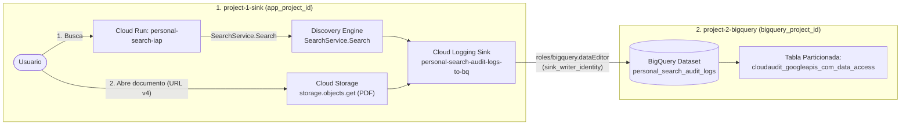

# Exportación Cross-Project de Audit Logs a BigQuery (`Personal Search`)

La infraestructura de auditoría está dividida en **dos módulos independientes de Terraform** para que cada proyecto pueda administrarse con sus propios permisos y estados:

```text
audit-logs/
├── project-1-sink/        # Proyecto 1 (Origen): Activa DATA_READ (Discovery Engine + GCS) y crea el Sink
└── project-2-bigquery/    # Proyecto 2 (Destino): Crea el dataset de BigQuery y autoriza al Sink
```



---

## Qué Eventos se Capturan

| Acción del Usuario | `protoPayload.serviceName` | `protoPayload.methodName` | `auditConfig` (`DATA_READ`) en Proyecto 1 |
|---|---|---|---|
| **Buscar** (`POST /api/search` y `POST /api/search/documents`) | `discoveryengine.googleapis.com` | `google.cloud.discoveryengine.v1.SearchService.Search` | `discoveryengine.googleapis.com` |
| **Abrir un documento** (descarga/lectura del PDF vía URL firmada v4 de `/api/doc_link`) | `storage.googleapis.com` | `storage.objects.get` | `storage.googleapis.com` |

Todos los eventos caen en una única tabla particionada por día en el **Proyecto 2**:
`<bigquery_project_id>.<bigquery_dataset_id>.cloudaudit_googleapis_com_data_access`

---

## Estructura de la Tabla en BigQuery y Schema del Payload

Cuando Cloud Logging enruta logs de `cloudaudit.googleapis.com/data_access` hacia BigQuery (con `use_partitioned_tables = true`), crea automáticamente la tabla particionada por día **`cloudaudit_googleapis_com_data_access`** mapeando cada `LogEntry` y su `AuditLog` (`type.googleapis.com/google.cloud.audit.AuditLog`):

### 1. Columnas principales de `cloudaudit_googleapis_com_data_access`

| Columna en BigQuery | Tipo | Descripción |
|---|---|---|
| `timestamp` | `TIMESTAMP` | Fecha y hora exacta del evento (columna de partición por día). |
| `insertId` | `STRING` | Identificador único de la entrada de log. |
| `logName` | `STRING` | Ruta del log en el Proyecto 1 (`projects/<app_project_id>/logs/cloudaudit.googleapis.com%2Fdata_access`). |
| `severity` | `STRING` | Nivel de severidad (`INFO`, `NOTICE`, `ERROR`). |
| `resource.type` / `resource.labels` | `RECORD` | Recurso auditado (`audited_resource`, `gcs_bucket`, etc.) y etiquetas (`project_id`, `service`, `method`). |
| `protopayload_auditlog` | `RECORD` | Estructura principal del evento de auditoría (`google.cloud.audit.AuditLog`). |

### 2. Campos clave dentro de `protopayload_auditlog`

| Campo en `protopayload_auditlog` | Tipo | Qué contiene en `Personal Search` |
|---|---|---|
| `serviceName` | `STRING` | `discoveryengine.googleapis.com` (búsqueda) o `storage.googleapis.com` (apertura de PDF). |
| `methodName` | `STRING` | `google.cloud.discoveryengine.v1.SearchService.Search` o `storage.objects.get`. |
| `resourceName` | `STRING` | • **Búsqueda**: `projects/<project>/locations/global/collections/default_collection/engines/<engine>/servingConfigs/default_search`<br>• **Apertura de PDF**: `projects/_/buckets/<bucket>/objects/<ruta_objeto.pdf>` |
| `authenticationInfo.principalEmail` | `STRING` | Email de la cuenta o identidad autenticada que ejecutó la llamada. |
| `requestMetadata.callerIp` | `STRING` | IP de origen del cliente (`callerIp`) y User-Agent (`callerSuppliedUserAgent`). |
| `requestJson` | `STRING (JSON)` | Parámetros del request enviado a la API (`SearchRequest`). |
| `responseJson` | `STRING (JSON)` | Respuesta de la API (`SearchResponse`). En `SearchService.Search`, el array `$.results[*].id` contiene los IDs de los documentos devueltos en los resultados de búsqueda. |
| `status.code` / `status.message` | `RECORD` | Estado gRPC de la operación (`NULL` o `0` cuando es exitosa). |

### 3. Documentación Pública de Referencia (Google Cloud)

* **Esquema de tablas de Cloud Logging exportadas a BigQuery (`LogEntry` -> BigQuery)**:
  https://cloud.google.com/logging/docs/export/bigquery#bigquery-schema
* **Referencia oficial del payload `google.cloud.audit.AuditLog` (`protopayload_auditlog`)**:
  https://cloud.google.com/logging/docs/reference/audit/auditlog/rest/Shared.Types/AuditLog
* **Estructura general de Cloud Audit Logs**:
  https://cloud.google.com/logging/docs/audit/understanding-audit-logs
* **Audit Logging de Discovery Engine (`discoveryengine.googleapis.com` / `SearchService.Search`)**:
  https://cloud.google.com/generative-ai-app-builder/docs/audit-logging
* **Audit Logging de Cloud Storage (`storage.googleapis.com` / `storage.objects.get`)**:
  https://cloud.google.com/storage/docs/audit-logging

---

## Cómo Desplegar en Otro Ambiente

### Paso 1: Aplicar en el Proyecto 1 (`project-1-sink`)

1. Edita [`project-1-sink/terraform.tfvars`](project-1-sink/terraform.tfvars) (o copia [`project-1-sink/terraform.tfvars.example`](project-1-sink/terraform.tfvars.example)):

   ```hcl
   app_project_id      = "PROYECTO_1_PERSONAL_SEARCH"
   bigquery_project_id = "PROYECTO_2_BIGQUERY_DESTINO"
   ```

2. Inicializa, aplica y obtén el `sink_writer_identity` generado por Cloud Logging:

   ```bash
   terraform -chdir=audit-logs/project-1-sink init
   terraform -chdir=audit-logs/project-1-sink apply

   SINK_WRITER=$(terraform -chdir=audit-logs/project-1-sink output -raw sink_writer_identity)
   echo "$SINK_WRITER"
   # -> serviceAccount:service-<PROJECT_1_NUMBER>@gcp-sa-logging.iam.gserviceaccount.com
   ```

### Paso 2: Aplicar en el Proyecto 2 (`project-2-bigquery`)

1. Edita [`project-2-bigquery/terraform.tfvars`](project-2-bigquery/terraform.tfvars) (o copia [`project-2-bigquery/terraform.tfvars.example`](project-2-bigquery/terraform.tfvars.example)) pegando el `sink_writer_identity` del Paso 1:

   ```hcl
   bigquery_project_id  = "PROYECTO_2_BIGQUERY_DESTINO"
   sink_writer_identity = "serviceAccount:service-<PROJECT_1_NUMBER>@gcp-sa-logging.iam.gserviceaccount.com"
   ```

2. Inicializa y aplica en el Proyecto 2:

   ```bash
   terraform -chdir=audit-logs/project-2-bigquery init
   terraform -chdir=audit-logs/project-2-bigquery apply
   ```

---

## Consultas en BigQuery (Proyecto 2)

### 1. Eventos recientes (`SEARCH` y `DOCUMENT_OPEN`)

```sql
SELECT
  timestamp,
  CASE
    WHEN protopayload_auditlog.serviceName = 'discoveryengine.googleapis.com' THEN 'SEARCH'
    WHEN protopayload_auditlog.serviceName = 'storage.googleapis.com'         THEN 'DOCUMENT_OPEN'
  END AS user_action,
  protopayload_auditlog.serviceName AS service_name,
  protopayload_auditlog.methodName AS method_name,
  protopayload_auditlog.resourceName AS resource_name,
  protopayload_auditlog.authenticationInfo.principalEmail AS principal_email,
  protopayload_auditlog.requestMetadata.callerIp AS caller_ip
FROM
  `<PROYECTO_2_BIGQUERY>.personal_search_audit_logs.cloudaudit_googleapis_com_data_access`
WHERE
  TIMESTAMP_TRUNC(timestamp, DAY) >= TIMESTAMP_SUB(CURRENT_TIMESTAMP(), INTERVAL 7 DAY)
ORDER BY
  timestamp DESC
LIMIT 100;
```

### 2. Cálculo de CTR por Documento

Al importar documentos desde Cloud Storage (`gs://<bucket>/<object>`), Discovery Engine les asigna como `doc_id` los primeros 32 caracteres hexadecimales de `SHA256("gs://<bucket>/<object>")` y registra los `results[*].id` devueltos en cada búsqueda dentro de `protopayload_auditlog.responseJson`. Cruzando ese `doc_id` con las lecturas `storage.objects.get` en GCS se obtiene el CTR por documento:

```sql
WITH
  impressions AS (
    SELECT
      JSON_VALUE(result, '$.id') AS doc_id,
      COUNT(*) AS search_impressions
    FROM
      `disco-ascent-512423-r1.personal_search_audit_logs.cloudaudit_googleapis_com_data_access`,
      UNNEST(JSON_QUERY_ARRAY(protopayload_auditlog.responseJson, '$.results')) AS result
    WHERE
      protopayload_auditlog.serviceName = 'discoveryengine.googleapis.com'
      AND protopayload_auditlog.methodName = 'google.cloud.discoveryengine.v1.SearchService.Search'
    GROUP BY
      doc_id
  ),
  clicks AS (
    SELECT
      gcs_uri,
      SUBSTR(TO_HEX(SHA256(gcs_uri)), 1, 32) AS doc_id,
      COUNT(*) AS document_opens
    FROM (
      SELECT
        CONCAT(
          'gs://',
          REGEXP_EXTRACT(protopayload_auditlog.resourceName, r'buckets/([^/]+)/objects/'),
          '/',
          REGEXP_EXTRACT(protopayload_auditlog.resourceName, r'buckets/[^/]+/objects/(.+)$')
        ) AS gcs_uri
      FROM
        `disco-ascent-512423-r1.personal_search_audit_logs.cloudaudit_googleapis_com_data_access`
      WHERE
        protopayload_auditlog.serviceName = 'storage.googleapis.com'
        AND protopayload_auditlog.methodName = 'storage.objects.get'
    )
    GROUP BY
      gcs_uri
  )
SELECT
  COALESCE(c.gcs_uri, CONCAT('doc_id:', i.doc_id)) AS document,
  i.doc_id,
  IFNULL(i.search_impressions, 0) AS impressions,
  IFNULL(c.document_opens, 0) AS opens,
  ROUND(SAFE_DIVIDE(IFNULL(c.document_opens, 0), i.search_impressions) * 100, 2) AS ctr_pct
FROM
  impressions i
FULL OUTER JOIN
  clicks c
USING (doc_id)
ORDER BY
  opens DESC, impressions DESC;
```
